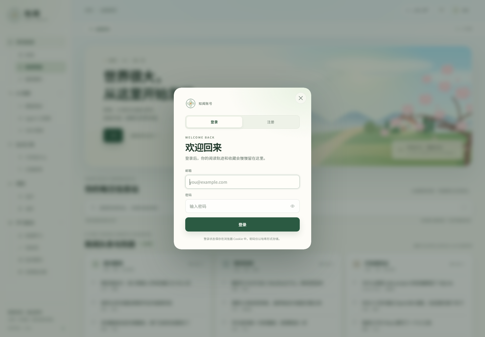

# 知闻 · News Compass

一个以「每日信息站」为核心的新闻门户，包含新闻聚合、工作区页签、理财行情、搜索与账户系统。前端是原生 HTML/CSS/JS，后端使用 Node.js 内置的 HTTP 与 SQLite 模块，零第三方依赖。




## 本地运行

需要 **Node.js 22.5 或更高版本**（使用内置 `node:sqlite`）。不需要 `npm install`。

```bash
npm start
```

然后访问：<http://127.0.0.1:4173/>

开发时可以使用自动重启：

```bash
npm run dev
```

> 登录依赖后端 API。请使用 `npm start` 启动，不要用 `python -m http.server` 或直接双击 `index.html` 打开需要登录的版本。

当前工作区已启动本地服务：`http://127.0.0.1:4173/`。

## 账户系统

- 注册、登录、退出登录、获取当前用户
- 密码使用 `scrypt` 加盐哈希，数据库不保存明文密码
- 会话使用随机 token，仅将 SHA-256 哈希存入 SQLite
- 登录 Cookie 设置 `HttpOnly`、`SameSite=Lax`
- 登录接口带基础频率限制
- 状态变更接口校验同源与 JSON Content-Type
- 用户数据和会话默认保存在 `data/app.db`，重启服务后仍然有效

页面上方右侧的「登录」按钮可以打开登录/注册窗口。登录后会显示用户头像、昵称与账户菜单。

### API

| 方法 | 路径 | 说明 |
| --- | --- | --- |
| GET | `/api/health` | 服务健康检查 |
| GET | `/api/auth/me` | 当前登录用户，未登录返回 `user: null` |
| POST | `/api/auth/register` | 注册，JSON：`{ "name", "email", "password" }` |
| POST | `/api/auth/login` | 登录，JSON：`{ "email", "password" }` |
| POST | `/api/auth/logout` | 退出登录 |

所有响应使用统一结构：

```json
{ "ok": true, "user": { "id": 1, "name": "知闻用户", "email": "you@example.com" } }
```

### 环境变量

| 变量 | 默认值 | 说明 |
| --- | --- | --- |
| `PORT` | `4173` | 监听端口 |
| `HOST` | `127.0.0.1` | 监听地址；部署时可改为 `0.0.0.0` |
| `DATA_DIR` | `./data` | 数据目录 |
| `DB_PATH` | `./data/app.db` | SQLite 文件路径 |
| `COOKIE_SECURE` | `false` | HTTPS 部署时设为 `true` |

### 上线前还需要

- 使用 HTTPS，并设置 `COOKIE_SECURE=true`
- 在前面放一层反向代理（Nginx / Caddy），限制请求体大小并补充访问日志
- 如开放公网注册，建议增加邮箱验证、找回密码和更严格的风控/验证码
- 将演示内容接入真实新闻、金价和油价 API

## 前端功能

- 左侧菜单打开工作区页签：可切换、关闭、自动回到「全部资讯」首页
- 新闻聚合页：综合、科技、娱乐、社区、购物、财经、开发、简报、AI 分类
  - 知乎、微博、微信、澎湃等来源榜单，热门 / 最新排序
  - 来源快捷跳转与卡片高亮
- 每个频道拥有独立页面：频道介绍、主推内容与更新列表
- AIHOT 精选：资讯阅读下新增「精选」，展示 AIHOT 的最新精选摘要、分类、来源与原文入口
- AI 工具：漫画制作、视频制作、歌曲制作
- 育儿：乐乐大事记、宝宝喂养、早教
- 理财栏目：金价、油价行情卡、近周期走势图与市场速览
- 固定侧边导航，可折叠分组，移动端抽屉导航
- 春日山谷原创 SVG 插画 Hero
- 每日信息站搜索：支持关键词高亮、键盘上下选择、`/` 或 `Ctrl/Cmd + K` 快速聚焦
- 三栏新闻卡片「换一批」刷新、已读状态、文章阅读弹层
- 发布日历：月份切换、日程 Agenda
- 天气浮层：未来 15 天预报、穿衣建议与出行提示
- 响应式布局、键盘与 reduced-motion 适配

### 更新 AIHOT 精选

精选页读取 `assets/aihot-featured.js`。把 AIHOT 订阅地址写入 `data/aihot-feed-url.txt`（已加入 `.gitignore`，不会提交），或设置为环境变量 `AIHOT_FEED_URL`，然后运行：

```bash
npm run sync:aihot
```

同步脚本会重新拉取最新 18 条精选摘要并生成快照。订阅地址中的 `aihot_actor` 不会写入前端页面或仓库。

## 文件结构

```
server.js               Node.js 后端：静态文件服务、SQLite、认证 API
auth.js                 前端登录/注册、账户菜单与会话恢复
index.html              页面结构
styles.css              视觉与响应式样式
app.js                  新闻、页签、搜索、日历与文章交互
package.json            启动脚本（无第三方依赖）
assets/landscape.svg    原创 Hero 插画
assets/mark.svg         品牌标志
assets/favicon.svg      站点图标
assets/aihot-featured.js AIHOT 精选快照（由同步脚本生成）
lib/aihot.js            AIHOT RSS 解析与抓取模块
scripts/sync-aihot.js   AIHOT 精选同步脚本
screenshots/            桌面端、新闻页、频道页、行情页与移动端预览
data/app.db             首次启动后生成的本地用户数据库（不提交）
```

## 说明

页面中的新闻、榜单、价格与日程均为界面演示数据，不代表真实报道、实时行情或投资建议。若要接入真实内容，可将 `app.js` 顶部的 `columns`、`channels`、`topics` 与 `newsDeskCategories` 数据替换为 API 返回结果。
