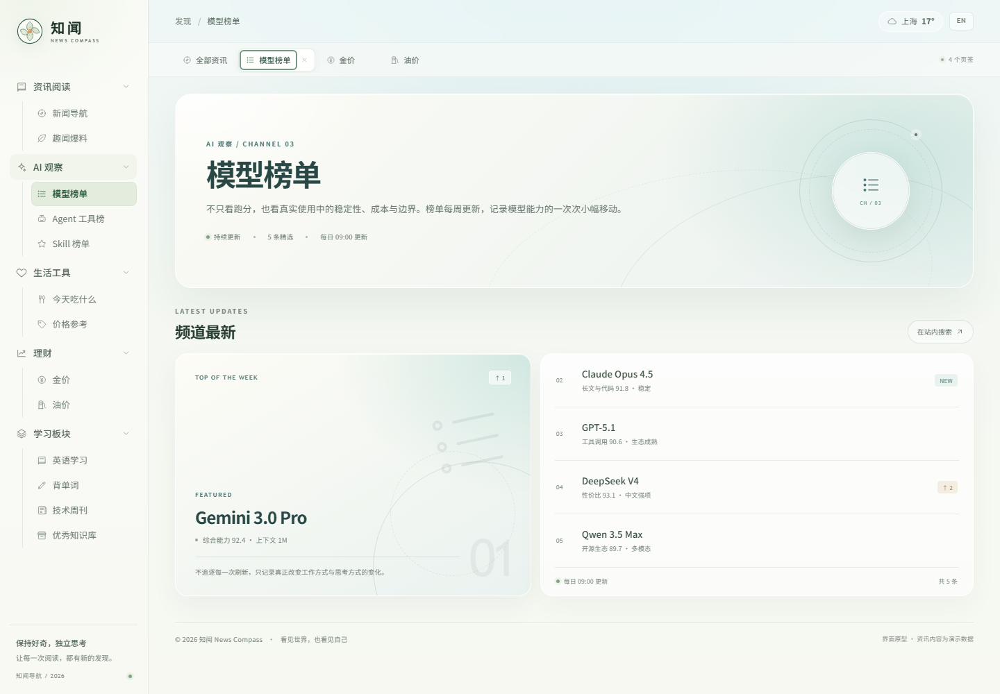
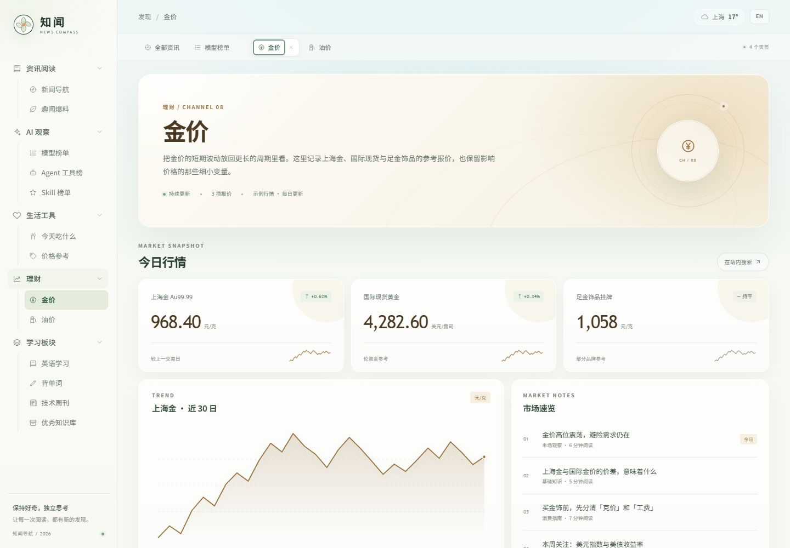
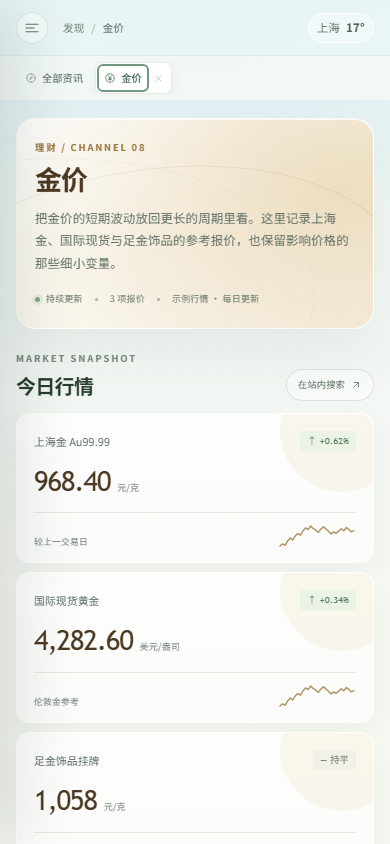

# 知闻 · News Compass

一个以「每日信息站」为核心的新闻门户界面原型，视觉参考了春日山谷、樱花与纸张质感的编辑台设计。


## 预览

直接双击 `index.html` 即可在浏览器中打开。也可以在当前目录启动一个本地静态服务器：

```bash
# Python 3
python -m http.server 4173

# 或者任意静态服务器，例如
npx serve .
```

然后访问 `http://localhost:4173`。

当前工作区已经通过 `python -m http.server 4173` 启动了本地预览：`http://127.0.0.1:4173/`。





移动端预览：

## 已实现

- 左侧菜单打开工作区页签：可切换、关闭、自动回到「全部资讯」首页
- 每个频道拥有独立页面：频道介绍、主推内容与更新列表
- 理财栏目：金价、油价行情卡、近周期走势图与市场速览
- 固定侧边导航，可折叠分组，移动端抽屉导航
- 春日山谷原创 SVG 插画 Hero
- 每日信息站搜索：支持关键词高亮、键盘上下选择、`/` 或 `Ctrl/Cmd + K` 快速聚焦
- 三栏新闻卡片「换一批」刷新、已读状态、文章阅读弹层
- 发布日历：月份切换、日程 Agenda
- 天气浮层、响应式布局、键盘与 reduced-motion 适配

## 文件结构

```
index.html              页面结构
styles.css              视觉与响应式样式
app.js                  数据、页签、搜索、日历与文章交互
assets/landscape.svg    原创 Hero 插画
assets/mark.svg         品牌标志
assets/favicon.svg      站点图标
screenshots/            桌面端、频道页、行情页与移动端预览
```

## 说明

页面中的新闻、榜单、价格与日程均为界面演示数据，不代表真实报道、实时行情或投资建议。若要接入真实内容，可将 `app.js` 顶部的 `columns`、`channels` 与 `topics` 数据替换为 API 返回结果。
